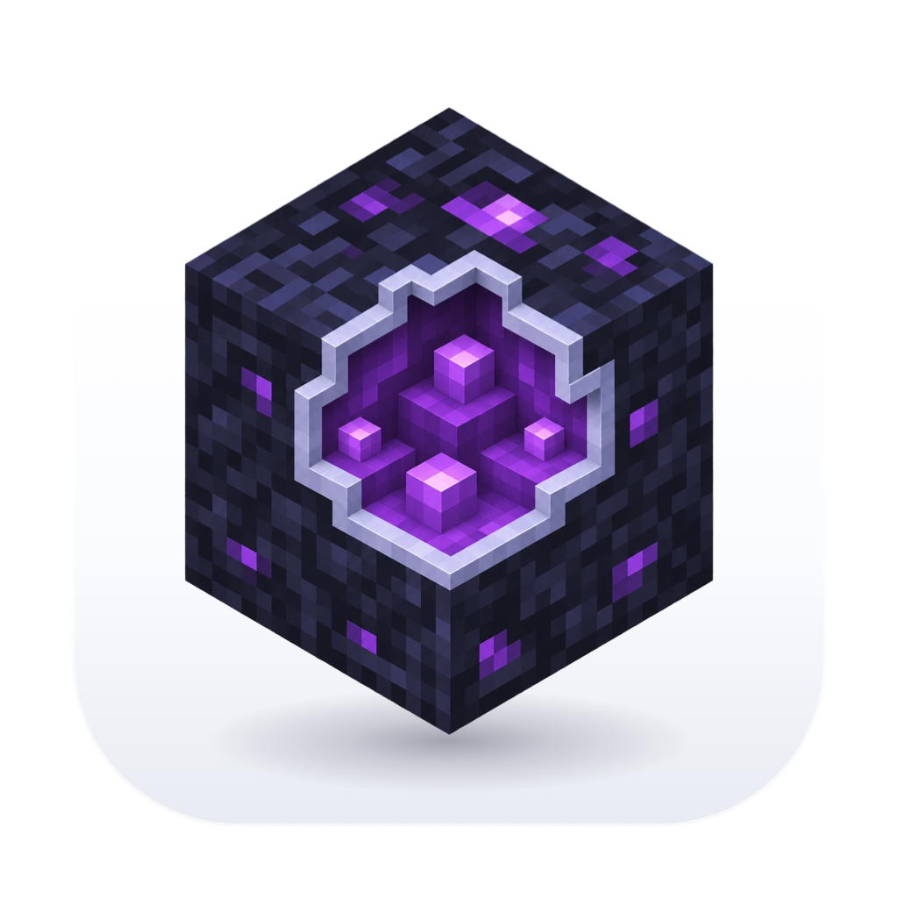

# Minecraft Galaxy ARM64 1.8.0 — Metal

- **Нативный Metal через bgfx.** В этом режиме мир и интерфейс рисуются в одном окне без контекста OpenGL. Metal может повысить FPS на Apple Silicon. Результат зависит от сцены, настроек и модели Mac. В лаунчере доступны лимит FPS и отдельная настройка VSync для Metal. OpenGL можно выбрать на главной.
- **Обновлённый лаунчер.** Новости MCGL на главной, выпадающие меню аккаунтов и настроек, новые иконки приложения и игрового окна.
- **Установка обновлений из лаунчера.** Следующую версию можно скачать, проверить и установить с перезапуском приложения.
- Исправлен запуск с актуальным официальным клиентом MCGL.

Для перехода с 1.7.5 скачайте DMG, закройте игру и лаунчер и замените приложение в «Программах». Профиль игры, настройки и аккаунты хранятся отдельно. Требуется Mac с Apple Silicon и macOS 14 или новее.

[Скачать 1.8.0](https://github.com/prilepv/mcgl-arm64/releases/tag/v1.8.0)
